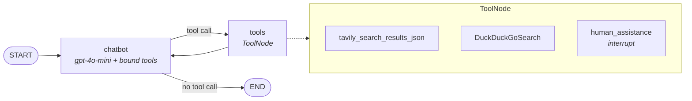
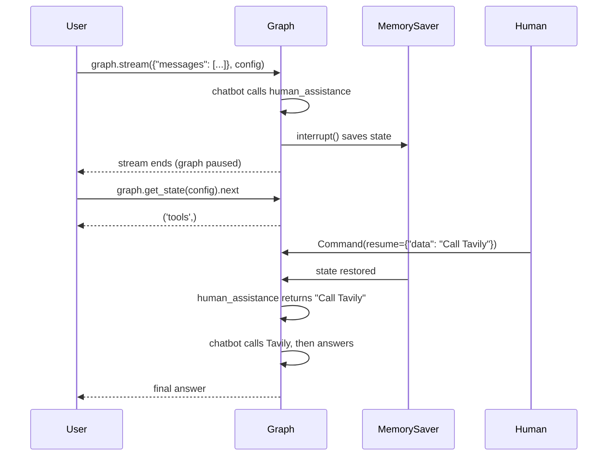

# Human-in-the-Loop Agent with LangGraph

A LangGraph agent that can search the web on its own, but **pauses and asks a human for guidance** when it decides it needs help. The pause is built on LangGraph's `interrupt()` and `Command(resume=...)` primitives, with a `MemorySaver` checkpointer that keeps the agent's state intact while it waits.

---

## Table of Contents

- [Overview](#overview)
- [How It Works](#how-it-works)
- [Architecture](#architecture)
- [The Three Tools](#the-three-tools)
- [Key Concepts](#key-concepts)
- [Tech Stack](#tech-stack)
- [Getting Started](#getting-started)
- [Usage Walkthrough](#usage-walkthrough)
- [Example Results](#example-results)
- [Project Structure](#project-structure)
- [Extending the Agent](#extending-the-agent)
- [Notes and Limitations](#notes-and-limitations)
- [Acknowledgements](#acknowledgements)

---

## Overview

Fully autonomous agents can pick the wrong tool or act on guesses, and fully manual systems defeat the point of automation. Human-in-the-loop (HIL) sits between the two: the agent handles routine requests itself and escalates to a human only when it chooses to.

In this notebook, an OpenAI `gpt-4o-mini` agent has three tools: two web search tools (Tavily and DuckDuckGo) and a `human_assistance` tool. Calling `human_assistance` freezes the graph until a human sends a response, after which the agent continues exactly where it stopped.

```
"When is the India vs England 1st T20i happening in 2025?"
    → agent calls Tavily on its own → answers

"I need help with creating code for configuring OpenAI keys?"
    → agent calls human_assistance → graph PAUSES
    → human replies "Call Tavily" → graph RESUMES
    → agent calls Tavily → answers
```

---

## How It Works

1. **State.** A `TypedDict` holds a `messages` list annotated with the `add_messages` reducer, so new messages are appended instead of overwriting history.
2. **Tools.** Tavily search (`max_results=2`), a DuckDuckGo search tool, and a custom `human_assistance` tool are defined and bound to the LLM with `llm.bind_tools(tools)`.
3. **Chatbot node.** Invokes the tool-bound LLM and asserts that it made **at most one tool call** per step.
4. **Tools node.** A prebuilt `ToolNode` executes whichever tool the LLM requested.
5. **Edges.** `START → chatbot`, then `tools_condition` routes to `tools` if there is a tool call or to `END` if there isn't. `tools → chatbot` closes the loop.
6. **Checkpointing.** The graph is compiled with `MemorySaver`, which is what lets `interrupt()` save state and `Command(resume=...)` restore it.
7. **Sessions.** Each run passes a `thread_id` (`"User_1"` in the notebook) so state is tracked per conversation.

---

## Architecture



### The interrupt and resume cycle



---

## The Three Tools

### 1. Tavily Search

```python
tavily_tool = TavilySearchResults(max_results=2)
```

Queries Tavily's search API and returns the top two results as structured JSON (title, URL, content, score). Requires a `TAVILY_API_KEY`. The agent used this tool in both examples in the notebook.

### 2. DuckDuckGo Search

```python
@tool
def DuckDuckGoSearch(query: str) -> str:
    """Use DuckDuckGo to search the web."""
    search = DuckDuckGoSearchRun()
    return search.invoke(query)
```

A free web search tool that needs no API key, wrapped with LangChain's `@tool` decorator. It is available to the agent but was not selected in the notebook's example runs.

### 3. Human Assistance (the HIL gate)

```python
@tool
def human_assistance(query: str) -> str:
    """Request assistance from a human regarding which tool to select."""
    human_response = interrupt({"query": query})
    return human_response["data"]
```

When the LLM calls this tool, `interrupt()` pauses the graph and saves its state. When a human resumes it with `Command(resume={"data": ...})`, the value under `"data"` becomes the tool's return value. From the LLM's point of view it simply called a tool and got a result back.

The docstring is what the LLM reads to decide when to use it, so editing it is the main way to change when the agent asks for help.

---

## Key Concepts

| Concept | What it does in this notebook |
|---------|-------------------------------|
| `interrupt()` | Pauses the graph inside `human_assistance` and saves the full state to the checkpointer. |
| `Command(resume=...)` | Resumes the paused graph and injects the human's response into the waiting tool call. |
| `MemorySaver` | In-memory checkpointer; required for `interrupt()` to work. |
| `thread_id` | Identifies a conversation so its state can be paused, inspected, and resumed. |
| `add_messages` | Reducer that appends new messages to the state instead of replacing the list. |
| `tools_condition` | Prebuilt router that sends the graph to `tools` if the last message has a tool call, otherwise to `END`. |
| `ToolNode` | Prebuilt node that executes the requested tool and returns a `ToolMessage`. |
| `graph.get_state(config).next` | Shows which node the graph will run next; `('tools',)` confirms it is paused at the interrupt. |

---

## Tech Stack

| Component | Choice |
|-----------|--------|
| Orchestration | LangGraph (`StateGraph`, `ToolNode`, `tools_condition`, `interrupt`, `Command`) |
| LLM | OpenAI `gpt-4o-mini` via `langchain-openai` |
| Search | Tavily (`TavilySearchResults`) and DuckDuckGo (`DuckDuckGoSearchRun`) from `langchain-community` |
| Tool definitions | `@tool` decorator from `langchain-core` |
| Persistence | `MemorySaver` checkpointer |
| Environment | Google Colab (Python 3) |

---

## Getting Started

### Prerequisites

- Python 3.10+
- An [OpenAI API key](https://platform.openai.com/api-keys)
- A [Tavily API key](https://tavily.com)

### Option 1: Google Colab (as written)

1. Open `HIL_LangGraph.ipynb` in Google Colab.
2. In the Secrets panel (key icon in the left sidebar), add `OPENAI_API_KEY` and `TAVILY_API_KEY`, and enable notebook access for both.
3. Run all cells.

### Option 2: Local Jupyter

1. Clone the repository and install dependencies:

```bash
   git clone <your-repo-url>
   cd <your-repo>
   pip install langgraph langchain_openai openai langchain_community \
               tavily-python duckduckgo-search jupyter
```

2. Set your API keys:

```bash
   export OPENAI_API_KEY="sk-..."
   export TAVILY_API_KEY="tvly-..."
```

3. Remove the Colab secrets cell (`from google.colab import userdata ...`), since the keys are already in your environment.

4. Launch the notebook:

```bash
   jupyter notebook HIL_LangGraph.ipynb
```

---

## Usage Walkthrough

### Example 1: The agent answers on its own

```python
user_input = "When is the India vs England 1st T20i happening in 2025?"
config = {"configurable": {"thread_id": "User_1"}}

events = graph.stream(
    {"messages": [{"role": "user", "content": user_input}]},
    config,
    stream_mode="values",
)
for event in events:
    if "messages" in event:
        event["messages"][-1].pretty_print()
```

The agent decides this is a straightforward search, calls Tavily directly, and answers. No interrupt fires.

### Example 2: The agent asks a human

**Step 1. Send the query.** The agent calls `human_assistance`, and the stream stops.

```python
user_input = "I need help with creating code for configuring OpenAI keys?"
config = {"configurable": {"thread_id": "User_1"}}

events = graph.stream(
    {"messages": [{"role": "user", "content": user_input}]},
    config,
    stream_mode="values",
)
for event in events:
    if "messages" in event:
        event["messages"][-1].pretty_print()
```

**Step 2. Confirm the graph is paused.**

```python
snapshot = graph.get_state(config)
snapshot.next   # ('tools',)
```

**Step 3. Resume with the human's guidance.**

```python
human_command = Command(resume={"data": "Call Tavily"})

events = graph.stream(human_command, config, stream_mode="values")
for event in events:
    if "messages" in event:
        event["messages"][-1].pretty_print()
```

The human's text is returned from `human_assistance` as a tool result. The agent then calls Tavily and writes its answer. The resume value can carry richer instructions than a tool name.

---

## Example Results

**Example 1: autonomous**

```
Human:  When is the India vs England 1st T20i happening in 2025?
AI:     Tool call → tavily_search_results_json
        query: "India vs England 1st T20i 2025 date"
Tool:   [2 search results]
AI:     The 1st T20I is scheduled for January 22, 2025, at Eden Gardens,
        Kolkata, starting at 7:00 PM IST.
```

**Example 2: human-in-the-loop**

```
Human:  I need help with creating code for configuring OpenAI keys?
AI:     Tool call → human_assistance
        query: "how to create code for configuring OpenAI API keys in a project"

        [graph paused, snapshot.next == ('tools',)]
        [human resumes with Command(resume={"data": "Call Tavily"})]

Tool:   human_assistance → "Call Tavily"
AI:     Tool call → tavily_search_results_json
        query: "OpenAI API key configuration code example"
Tool:   [2 search results]
AI:     Step-by-step guide: get an API key, store it in an environment
        variable or .env file, install the SDK, and example client code.
```

Outputs are abridged. Answers depend on live search results and will vary between runs.

---

## Project Structure

```
.
├── HIL_LangGraph.ipynb   # Main notebook
└── README.md
```

The notebook writes no files at runtime. All state lives in memory through `MemorySaver`.

---

## Extending the Agent

**Tighten when the agent asks for help.** Make the `human_assistance` docstring more specific, for example: only ask when unsure which search tool fits, or when the request is sensitive.

**Approve every tool call.** Compile with `interrupt_before=["tools"]` so the graph pauses before any tool runs, letting a human review each planned call.

**Persist paused sessions.** Swap `MemorySaver` for a durable checkpointer such as `SqliteSaver` or `PostgresSaver` so interrupted threads survive a restart.

**Use unique sessions.** Generate a new `thread_id` per conversation (for example with `uuid.uuid4()`) instead of reusing `"User_1"`.

**Add a human-facing UI.** Wrap the stream and resume calls in a small Gradio, Streamlit, or FastAPI app so a reviewer can respond without running Python.

---

## Notes and Limitations

- **State is in memory.** `MemorySaver` loses all checkpoints, including paused threads, when the kernel restarts.
- **One tool call per step.** The `assert(len(message.tool_calls) <= 1)` in the chatbot node will raise an error if the LLM requests parallel tool calls.
- **Resuming is programmatic.** The human responds by running `Command(resume=...)` in code; there is no UI.
- **No timeout.** A paused graph waits indefinitely for a resume.
- **Fixed response shape.** The resume payload must contain a `"data"` key, because `human_assistance` reads `human_response["data"]`.
- **Shared thread in the examples.** Both examples use `thread_id="User_1"`, so the second query runs with the first conversation's history in context.
- **The LLM decides when to escalate.** Whether `human_assistance` is called depends on the model's judgment, so the same query may not always trigger an interrupt.
- **Deprecations.** `TavilySearchResults` is deprecated in favour of `TavilySearch` from the `langchain-tavily` package, and `langchain-community` shows a sunset warning on import. Both still work in the notebook.

---

## Acknowledgements

- [LangGraph](https://github.com/langchain-ai/langgraph) for the stateful graph framework and HIL primitives
- [LangChain](https://www.langchain.com) for tool integrations
- [OpenAI](https://openai.com) for `gpt-4o-mini`
- [Tavily](https://tavily.com) and [DuckDuckGo](https://duckduckgo.com) for search
